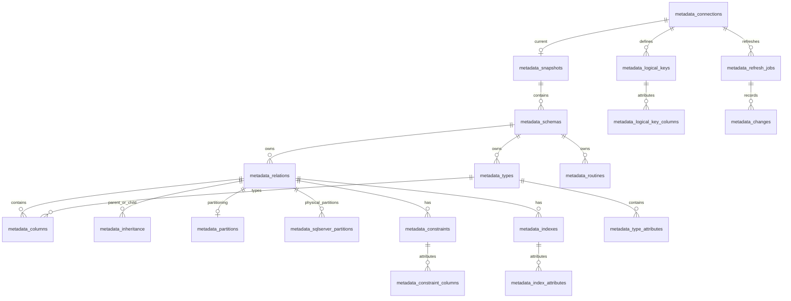

# Relational metadata storage (version 2)

Current metadata has no JSON/JSONB document columns. It represents one current state per connection, replaced atomically after each successful refresh. Source catalog IDs are bigint identifiers scoped by `connection_id`, so identical IDs from different databases cannot collide. Composite foreign keys enforce this scope. The profile's `engine` selects PostgreSQL or SQL Server; PostgreSQL remains the storage engine.

| Tables                                                  | Purpose                                                                                                     |
| ------------------------------------------------------- | ----------------------------------------------------------------------------------------------------------- |
| `metadata_connections`                                  | Encrypted connection profiles, refresh interval, history retention                                          |
| `metadata_snapshots`                                    | One header per connection: capture job/time, database/user/version, sizes/counts                            |
| `metadata_schemas`                                      | Namespaces, ownership, comments, system flag                                                                |
| `metadata_relations`                                    | Tables/views/foreign tables, schema FK, names, owner, comments, definitions and statistics                  |
| `metadata_inheritance`                                  | Ordered parent/child associations, including multiple inheritance                                           |
| `metadata_columns`                                      | Ordered table columns, type FK, formatted type/typmod, NULL/default/identity/generated properties, comments |
| `metadata_types`, `metadata_type_attributes`            | Type dictionary, array/domain references and ordered composite attributes                                   |
| `metadata_constraints`, `metadata_constraint_columns`   | Constraints and ordered local/referenced column FKs                                                         |
| `metadata_indexes`, `metadata_index_attributes`         | Index method/state, linked constraint, ordered expressions and INCLUDE attributes                           |
| `metadata_partitions`                                   | One row per partition-tree node: own method/key and bounds in parent                                        |
| `metadata_sqlserver_partitions`                         | Physical SQL Server partitions, functions/schemes, boundary values, filegroups and row estimates             |
| `metadata_routines`                                     | Schema, function/procedure identity, signature/result/language/definition                                   |
| `metadata_logical_keys`, `metadata_logical_key_columns` | Platform key configuration and ordered source-column positions                                              |
| `metadata_refresh_jobs`, `metadata_changes`             | Refresh outcomes and field-level deltas                                                                     |
| `metadata_history_edges`                                | Previously observed parent/child links for scoped history of removed descendants                            |
| `metadata_storage_version`                              | Schema compatibility marker; no legacy-data conversion                                                      |



Primary/foreign keys enforce ownership of local and referenced constraint attributes. Source type and array/domain references use deferred FKs, allowing mutually referencing type dictionaries to be inserted in one transaction. Ordered member tables replace attribute arrays. Index expressions and SQL definitions remain text because they are SQL expressions, not relational associations.

`metadata_types.source_relation_oid` is the raw PostgreSQL class OID associated with a row/composite type, or the SQL Server table-type object ID; it may identify a relation outside the browsable user-table subset. Platform logical-key positions intentionally survive source column removal so the UI can report an invalid key and let the operator repair it. They are configuration, not enforced source constraints.

SQL Server identity seed/increment and constraint enabled state occupy typed columns. `metadata_sqlserver_partitions` stores physical partition number/ID, function/scheme, boundary direction and values, filegroup and row estimate, with a foreign key to its owning table. PostgreSQL tree partitions continue using `metadata_partitions` and `metadata_inheritance`. SQL Server index IDs combine the table object ID and table-local index ID into a bigint. SQL type expressions and partition boundary literals remain text.

The worker reads relational rows into transient objects to compute deltas, then replaces the current relational rows and records changes in one transaction. This is a complete refresh, not incremental per-row upserts. API read transactions use repeatable-read isolation; they see a complete old or new state. Browsing schemas, relation lists, routines and columns uses SQL filters/joins; table detail only retrieves its relevant type graph. The backing database can be queried directly without JSON extraction.

Only `metadata_changes.previous_value` and `new_value` use JSONB, since historical values can be strings, numbers, booleans or removed/added object descriptions. No old complete snapshots are retained. Cleanup/retention deletes these entries, retaining job status summaries and current metadata.

## SQL examples

List user table columns and types (add a `connection_id` predicate if several sources are configured):

```sql
SELECT p.name AS connection, s.name AS schema, r.name AS table_name,
       c.position, c.name AS column_name, c.formatted_type, c.nullable,
       c.default_expression, c.identity_kind, c.generated_kind, c.comment
FROM metadata_columns c
JOIN metadata_relations r ON (r.connection_id,r.id)=(c.connection_id,c.table_id)
JOIN metadata_schemas s ON (s.connection_id,s.id)=(r.connection_id,r.schema_id)
JOIN metadata_connections p ON p.id=c.connection_id
WHERE NOT s.is_system
ORDER BY p.name,s.name,r.name,c.position;
```

Find tables without a source primary key:

```sql
SELECT s.name AS schema, r.name AS table_name
FROM metadata_relations r
JOIN metadata_schemas s ON (s.connection_id,s.id)=(r.connection_id,r.schema_id)
WHERE r.relkind IN ('r','p') AND NOT EXISTS (
  SELECT 1 FROM metadata_constraints k
  WHERE k.connection_id=r.connection_id AND k.table_id=r.id AND k.type='p'
);
```

Inspect ordered index attributes:

```sql
SELECT i.name, i.method, i.is_unique, a.ordinal, a.expression, a.included
FROM metadata_indexes i
JOIN metadata_index_attributes a ON (a.connection_id,a.index_id)=(i.connection_id,i.id)
ORDER BY i.connection_id,i.name,a.ordinal;
```

The SQL Server extension upgrades v1.2 relational databases additively, retaining existing PostgreSQL profiles and history. The schema definition is [src/schema.sql](../src/schema.sql); startup refuses legacy `metadata_snapshots.payload` storage and performs no destructive reset or legacy-data migration. Only that older JSON layout requires a fresh application database.
